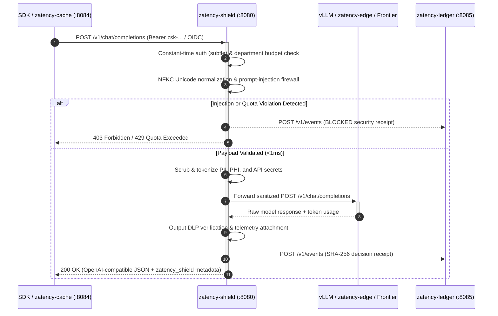

# zatency-shield — Zero-Trust Rust AI Gateway & Inline PII/Prompt Firewall

**Sub-Millisecond Compiled Rust (`Axum` + `Tokio`) Reverse Proxy for Inline PII/PHI Redaction, NFKC Prompt-Injection Defense, Department Token Budgets, and Sovereign SLM/LLM Routing.**

[](https://zatency.com)
[](#api-reference)
[](https://www.apache.org/licenses/LICENSE-2.0)
[](#inspection-latency--security-benchmarks)
[](#quickstart)

---

## Sections
- [Overview](#overview)
- [Execution Lifecycle & Architecture](#execution-lifecycle--architecture)
- [Core Capabilities](#core-capabilities)
- [Inspection Latency & Security Benchmarks](#inspection-latency--security-benchmarks)
- [Quickstart](#quickstart)
- [Drop-In SDK Usage](#drop-in-sdk-usage)
- [API Reference](#api-reference)
- [Configuration](#configuration)
- [Open-Core vs. Enterprise Edition](#open-core-vs-enterprise-edition)
- [Ecosystem Integration](#ecosystem-integration)

---

## Overview

**`zatency-shield`** is the zero-trust perimeter security and inference routing gateway of the **[Zatency Platform](https://github.com/zatency)**. Built in compiled **Rust (`Axum` + `Tokio`)**, it sits as a drop-in OpenAI-compatible reverse proxy inside your single-tenant VPC or air-gapped cluster—inspecting payloads in microseconds to block prompt injections, scrub sensitive PII/PHI/API secrets before external egress, and route traffic across sovereign Small Language Models (SLMs) and frontier endpoints.

Engineered for **AWS, Microsoft Azure, Google Cloud**, and **physically air-gapped environments**, `zatency-shield` eliminates Python proxy GIL bottlenecks and ensures zero external telemetry leaves your security boundary.

---

## Execution Lifecycle & Architecture

`zatency-shield` runs on default port **`:8080`**, inspecting incoming traffic from `zatency-cache` (`:8084`) or enterprise SDKs before routing sanitized requests to `zatency-edge` (`:8787`), `zatency-forge` (`:8087`) vLLM endpoints, or upstream providers while sealing audit receipts in `zatency-ledger` (`:8085`):



---

## Core Capabilities

- **Sub-Millisecond Rust Inspection Engine:** Compiled `Axum` + `Tokio` asynchronous pipeline inspects prompts in microseconds (~40–350 µs), avoiding Python runtime latency overhead under high concurrency.
- **Inline PII, PHI & Secret Redaction:** Detects and masks emails, SSNs, credit cards, phone numbers, and cloud/LLM credentials (`sk-...`, `AKIA...`) *before* prompts leave your private network boundary.
- **NFKC Prompt-Injection Firewall:** Normalizes homoglyphs and Unicode obfuscation before blocking jailbreak, instruction-override, and system-prompt extraction attempts with `403 Forbidden` enforcement.
- **Constant-Time Virtual Key Authentication:** Validates `zsk-...` gateway bearer tokens using cryptographic constant-time comparison (`subtle`) to prevent timing side-channel attacks.
- **Zero-Telemetry Data Sovereignty:** Executes single-tenant inside Docker, Kubernetes (`EKS` / `AKS` / `GKE`), or bare-metal air-gapped clusters with local sandbox echo mode for offline CI testing.
- **Drop-In OpenAI SDK Compatibility:** Migrate existing Python, TypeScript, LangChain, or LlamaIndex applications immediately by updating `base_url` to `http://localhost:8080/v1`.

---

## Inspection Latency & Security Benchmarks

| Security & Routing Stage | Execution Engine | Typical Latency | Action on Policy Violation |
| :--- | :--- | :---: | :--- |
| **Virtual Key Auth & Rate Limit** | Rust `subtle` constant-time check | **~5 µs** | `401 Unauthorized` / `429 Too Many Requests` |
| **NFKC Prompt-Injection Guard** | Compiled Rust pattern & heuristic engine | **~35 µs** | `403 Forbidden` + `zatency-ledger` alert |
| **Inline PII / Secret Redaction** | Zero-copy regex & entity tokenizer | **~80–250 µs** | Masks entity (`[REDACTED_EMAIL_1]`) |
| **Total Gateway Overhead (p99)** | Full ingress + egress inspection | **< 1.0 ms** | Attached in `zatency_shield` response object |

---

## Quickstart

### Option 1: Run with Docker

```bash
git clone https://github.com/zatency/zatency-shield.git
cd zatency-shield

docker build -t zatency-shield .

# Run in Local Sandbox Mode (no upstream API key required)
docker run -p 8080:8080 zatency-shield

# Or connect to an upstream OpenAI-compatible provider (vLLM, Ollama, OpenAI)
docker run -p 8080:8080 \
  -e UPSTREAM_BASE_URL="https://api.openai.com/v1" \
  -e UPSTREAM_API_KEY="sk-your-upstream-key" \
  zatency-shield
```

### Option 2: Run from Source (Cargo)

```bash
git clone https://github.com/zatency/zatency-shield.git
cd zatency-shield
cargo run --release
```

---

## Drop-In SDK Usage

Point any OpenAI-compatible client to `http://localhost:8080/v1` using a Zatency Shield virtual key (`zsk-...`):

### Python (`openai` SDK)

```python
from openai import OpenAI

client = OpenAI(
    base_url="http://localhost:8080/v1",
    api_key="zsk-local-dev-key",
)

response = client.chat.completions.create(
    model="gpt-4o-mini",
    messages=[
        {"role": "user", "content": "Email john@acme.com regarding SSN 123-45-6789"}
    ],
)

print(response.choices[0].message.content)
```

### cURL Verification

```bash
curl -X POST http://localhost:8080/v1/chat/completions \
  -H "Authorization: Bearer zsk-local-dev-key" \
  -H "Content-Type: application/json" \
  -d '{
    "model": "gpt-4o-mini",
    "messages": [
      {"role": "user", "content": "Email john@acme.com regarding SSN 123-45-6789"}
    ]
  }'
```

**Example Response (`zatency_shield` inspection telemetry attached):**

```json
{
  "id": "chatcmpl-5d28dd5a-d3f1-45a9-bde6-c1589fa77988",
  "object": "chat.completion",
  "model": "gpt-4o-mini",
  "choices": [
    {
      "index": 0,
      "message": {
        "role": "assistant",
        "content": "[Sandbox Echo — Sanitized Payload]: Email [REDACTED_EMAIL_1] regarding SSN [REDACTED_SSN_2]"
      },
      "finish_reason": "stop"
    }
  ],
  "zatency_shield": {
    "request_id": "5d28dd5a-d3f1-45a9-bde6-c1589fa77988",
    "inspection_latency_us": 42,
    "pii_entities_redacted": 2,
    "mode": "local_sandbox"
  }
}
```

---

## API Reference

All inference endpoints require Bearer authentication (`Authorization: Bearer zsk-...`) and expose Prometheus OpenMetrics telemetry at `GET /metrics`.

| Method | Endpoint | Description |
| :--- | :--- | :--- |
| `POST` | `/v1/chat/completions` | OpenAI-compatible inference gateway with inline PII/secret redaction and prompt-injection blocking. |
| `GET` | `/health` | Service liveness, version, and active upstream/sandbox mode probe (`200 OK` JSON). |
| `GET` | `/metrics` | Prometheus OpenMetrics endpoint (`zatency_shield_requests_total`, `zatency_shield_blocked_injections_total`, `zatency_shield_pii_redacted_total`, `zatency_shield_unauthorized_total`). |

---

## Configuration

| Environment Variable | Default | Description |
| :--- | :--- | :--- |
| `BIND_ADDR` | `0.0.0.0:8080` | Host IP and TCP port for the Rust gateway HTTP server. |
| `UPSTREAM_BASE_URL` | `https://api.openai.com/v1` | Target OpenAI-compatible inference endpoint (`vLLM`, `zatency-edge`, Ollama, OpenAI). |
| `UPSTREAM_API_KEY` | *(empty — runs in Sandbox Mode)* | Upstream bearer token. When omitted, `zatency-shield` runs in local echo sandbox mode. |
| `SHIELD_GATEWAY_KEY` | *(any `zsk-...` token)* | Optional static bearer key enforced via constant-time comparison (`subtle`). |
| `ZATENCY_LEDGER_URL` | `http://localhost:8085` | Optional downstream `zatency-ledger` endpoint for tamper-evident audit receipts. |
| `RUST_LOG` | `info` | Logging verbosity (`debug`, `info`, `warn`, `error`). |

---

## Open-Core vs. Enterprise Edition

| Capability | Community Edition (Apache 2.0) | Zatency Shield Enterprise |
| :--- | :---: | :---: |
| High-speed Rust (`Axum` + `Tokio`) OpenAI-compatible proxy | ✅ | ✅ |
| Inline regex PII & secret redaction | ✅ | ✅ |
| Rule-based NFKC prompt-injection blocking | ✅ | ✅ |
| Local ONNX NER & reversible cryptographic token vault | Roadmap | ✅ |
| Semantic caching (`zatency-cache`) & smart SLM routing | — | ✅ |
| SAML/OIDC SSO, RBAC & department token budgets | — | ✅ |
| Immutable SOC 2 / HIPAA / EU AI Act audit exports (`zatency-ledger`) | — | ✅ |

> **Enterprise Deployment:** Evaluating dedicated VPC deployment, custom fine-tuned SLMs (`zatency-forge`), or enterprise SLAs? [Schedule an Architecture Session](https://zatency.com/contact) or review the [System Architecture Blueprint](https://zatency.com/architecture).

---

## Ecosystem Integration

- **Sub-4ms Semantic Cache Ingress:** Sits directly behind **[`zatency-cache`](https://github.com/zatency/zatency-cache)** (`:8084`), inspecting and sanitizing every cache miss before upstream model execution.
- **Sovereign Edge & Domain SLM Routing:** Routes low-latency global traffic to **[`zatency-edge`](https://github.com/zatency/zatency-edge)** (`:8787`) and domain-specific workloads to quantized 7B–14B SLMs compiled by **[`zatency-forge`](https://github.com/zatency/zatency-forge)** (`:8087`).
- **Tamper-Evident Audit Logging:** Streams SHA-256 decision receipts to **[`zatency-ledger`](https://github.com/zatency/zatency-ledger)** (`:8085`) for **SOC 2 Type II, HIPAA, GDPR, RBI, and EU AI Act** compliance.

---

## License

Licensed under the [Apache License 2.0](https://www.apache.org/licenses/LICENSE-2.0).
